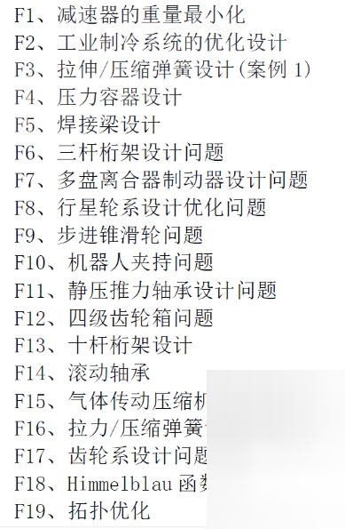
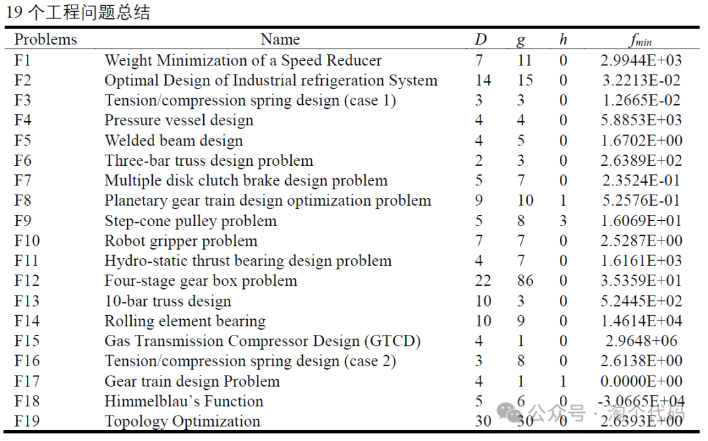
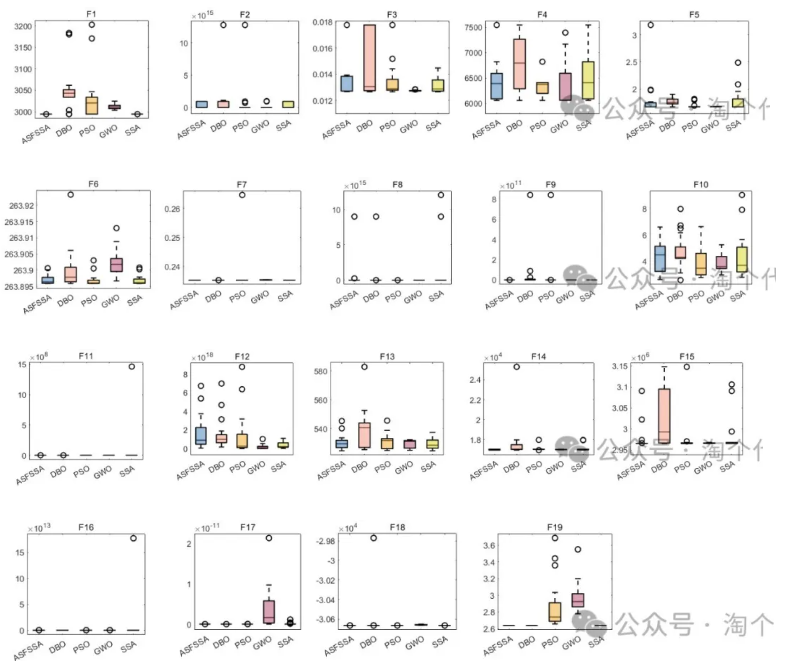
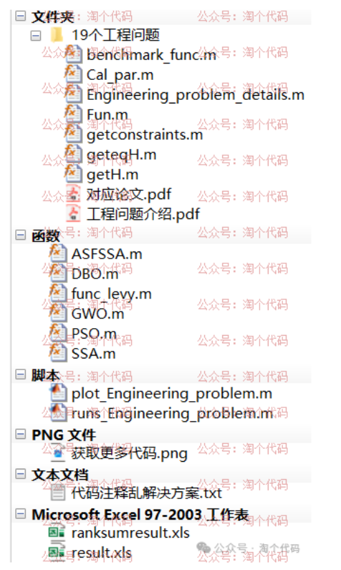
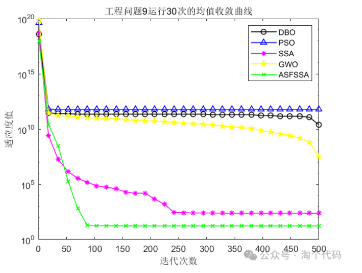
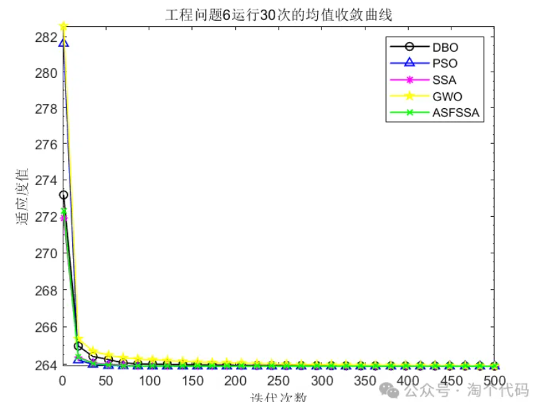
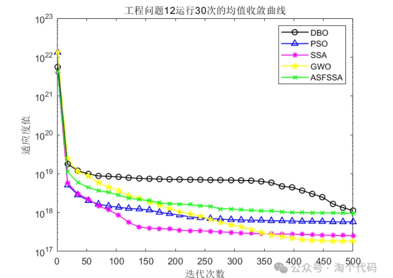
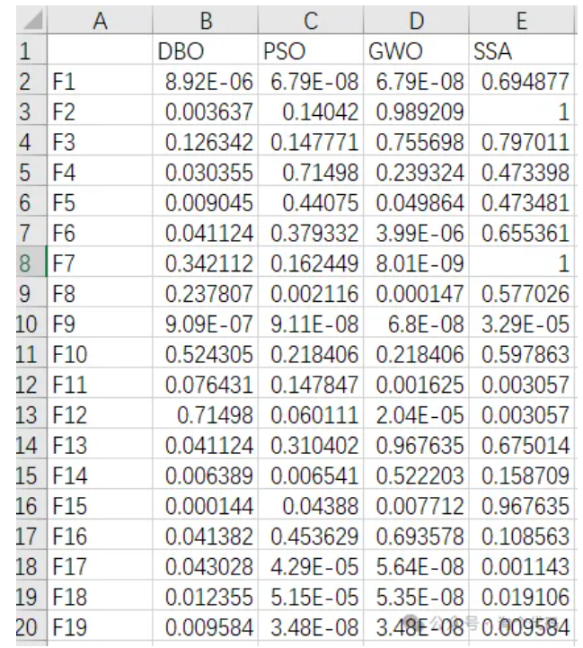
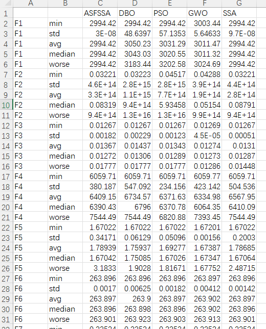

# Intelligent optimization algorithms optimize 19 engineering problems, commonly used indicators can be exported as Excel with one-click, optimal value, average value, standard deviation, worst value, median, rank sum test, box plot.

Common intelligent algorithm comparison methods, in addition to using the classic CEC function, are also commonly used for engineering optimization problems.
This issue implements a one-click statistical analysis of the indicators of intelligent algorithms on 19 types of engineering optimization problems! This enhances your paper's persuasiveness!
The 19 types of engineering optimization problems include the following:
\n        \n  
The introduction to the above engineering problems is available online and will not be elaborated here.
The theoretical values of the 19 engineering problems are as follows:
\n        \n      D is the dimension of the problem, g is the inequality constraint, h is the equality constraint, fmin is the theoretical optimal value.
Using MATLAB tools, we teach everyone how to directly complete the statistical analysis with one click, export an Excel table, and draw a boxplot simultaneously.
Algorithm replacement is very simple; just replace the algorithm name!
This issue takes the Adaptive Spiro-Turning Swarm Search Algorithm (ASFSSA) (click the link to jump, this algorithm can be obtained for free) as an example (usually there is a prominent algorithm to focus on), and compares it with the Dung Beetle Optimization Algorithm, Sparrow Optimization Algorithm, Particle Swarm Optimization Algorithm, and Grey Wolf Optimization Algorithm.
Each algorithm is run 30 times, tested in 19 types of engineering optimization problems, and the optimal value, average, standard deviation, median, worst value, and Wilcoxon rank sum test results are statistically analyzed. At the same time, boxplots and mean convergence curves are drawn.
In addition, previous CEC function indicator statistics have been reported by some users who found that the size of the boxplots was inconsistent, which looked ugly. This code has standardized the size of the boxplots. As follows, instead of drawing all boxplots on one graph, five are grouped together, effectively avoiding the problem of inconsistent sizes.
\n        \n  
Code directory is as follows:
In plot_Engineering_problem.m, the population size for each algorithm is set to 30, and the number of iterations is set to 500. The algorithms are run 30 times, resulting in a mean convergence curve. (It is important to note that the convergence curve is drawn based on the mean convergence curve. After running 30 times, the average value of the 30 runs is used to draw the curve. Since it is a stochastic algorithm, there is randomness with each run. Using the mean convergence curve can scientifically evaluate the quality of the algorithm.) The results are as follows:
There are a total of 19 engineering optimization problems, which will not be displayed one by one here.
Runs the script "runs_Engineering_problem.m", which upon execution, generates two Excel files: ranksumresult.xls and result.xls.
Rank-sum test result.xls is the statistical results of the rank-sum test, and result.xls is the statistical results for five indicators. Frequently, some friends ask why there are no intelligent algorithms in the statistical results of the rank-sum test. This is because, in a rank-sum test, there must be a benchmark; it is unnecessary to conduct a rank-sum test between oneself and others.
The results are as follows:
\n        \n      \n        \n      \n        \n  
ranksumresult.xls table:
\n        \n  
result.xls table:
\n        \n  
\n      \n  
After running runs_Engineering_problem.m, the following results will be printed in the command line window:

## Images

<!-- PAYMENT_BLOCK -->

## Get this dataset

- Payment link (Stripe): [Buy now](https://buy.stripe.com/3cs8yP7sY87d0vu9AB)
- Payment QR code: 

<!-- /PAYMENT_BLOCK -->
